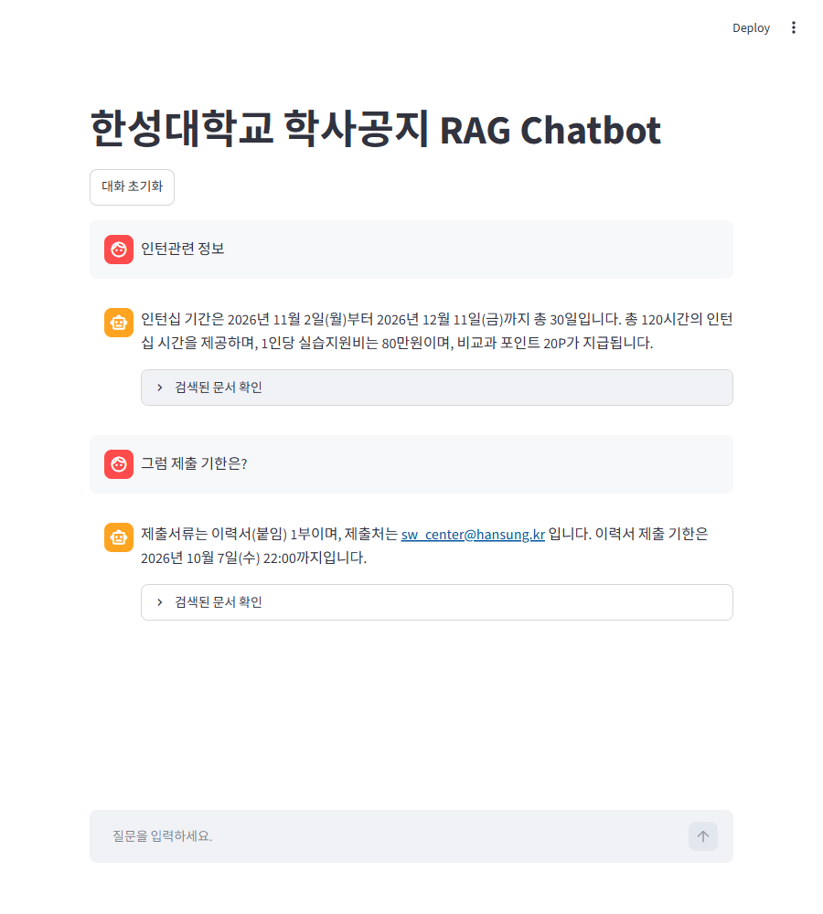
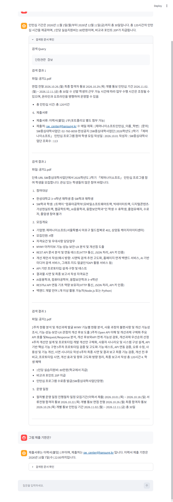

1. 연결 확인

```
질문:
RAG가 무엇인지 한 문장으로 설명해줘.

답변:
RAG(Retrieval-Augmented Generation)은 검색된 정보를 활용하여 생성 모델의 답변 품질을 향상시키는 기술입니다.
```

2. 문서 검색

```
데이터 폴더:
C:\2026-open\6w\data

문서 불러오기: 공지1.pdf

문서 불러오기: 공지2.pdf

불러온 전체 페이지 수: 4
생성된 Chunk 수: 8

질문:
인턴십 관련 공지의 주요 내용은 무엇인가요?

========== 검색 결과 1 ==========
파일: 공지2.pdf
페이지: 0

문서 내용:
단축 URL
SW중심대학사업단에서 2026학년도 2학기 「제머나이소프트」 인턴십 프로그램 참여 학생을 모집합니다. 관심 있는 학생들의 많은 참여 바랍니다.
 
1. 참여대상
- 한성대학교 3~4학년 재학생 중 SW학과 재학생
- SW학과 학생: 1트랙이 "컴퓨터공학부[모바일소프트웨어트랙, 빅데이터트랙, 디지털콘텐츠·가상현실트랙, 웹공학트랙], AI응용학과, 융합보안학과"인 학생
※ 휴학생, 졸업유예자, 수료자, 졸업생 참여 불가
 
2. 모집개요
- 기업명: 제머나이소프트(서울특별시 마포구 월드컵북로 402, 상암동 케이지아이티센터)
- 모집인원: 4명
- 자격요건 및 우대사항
담당업무
- MYMY 아카이브 기능·성능·보안·UX 분석 및 개선점 도출
- REST API 문서 분석 및 연동 테스트(HTTP 통신, JSON 처리, API 키 인증)
- 개선 제안서 작성(예시 방향: 시맨틱 검색·추천 고도화, 홈페이지 연계 백엔드 서비스, AI 기반 미디어 검색 서비스, 그래프·지도·얼굴인식API 활용
서비스 등)
- API 기반 프로토타입 설계·구현 및 테스트
- 결과물 시연 및 최종 보고서 작성
자격요건
- AI응용학과, 컴퓨터공학부, 융합보안학과 3~4학년
- RESTful API 연동 기초 역량 보유자(HTTP 통신, JSON 처리, API 키 인증)
- 백엔드 개발 언어 1개 이상 활용 가능자(Node.js 또는 Python)

========== 검색 결과 2 ==========
파일: 공지2.pdf
페이지: 0

문서 내용:
면접 전형 2026.10.26.(월)
최종 합격자 통보 2026.10.29.(목) 개별 통보
인턴십 기간 2026.11.02.(월) ~ 2026.12.11.(금) 총 30일
※ 선발 학생의 근무 가능 시간에 따라 업무 수행 시간은 조정될 수 있으며, 온라인과 오프라인을 병행하여 운영할 수 있음
- 총 인턴십 시간: 총 120시간
 
6. 제출서류
- 제출서류: 이력서(붙임) 1부(포트폴리오 별도 첨부 가능)
- 제출처: sw_center@hansung.kr
※ 메일 제목 : [제머나이소프트인턴십_이름_학번]
 
[문의]
SW중심대학사업단: 02-760-8059
한성공지
[SW중심대학사업단] 2026학년도 2학기 「제머나이소프트」 인턴십 프로그램 참여 학생 모집
작성일 : 2026.10.01 작성자 : SW중심대학사업단 조회수 : 113

========== 검색 결과 3 ==========
파일: 공지2.pdf
페이지: 0

문서 내용:
2주차 현황 분석 및 개선과제 발굴
MYMY 기능별 현황 분석, 사용 과정의 불편사항 및 개선 가능성 조사,
기능·성능·보안·UX 관점의 개선 후보 도출
3주차 Open API 이해 및 개선과제 구체화 주요API 호출 및Request/Response 분석, 개선 후보와API 연계 가능성 검토,
개선과제 우선순위 선정
4주차 개선안 설계 및 프로토타입 개발
개선안 구체화, 사용자 시나리오 및 시스템
구성 설계, API 기반 핵심 기능 구현
5주차 프로토타입 검증 및 고도화
기능 테스트, API 연동 검증, 오류 수정,
사용성 및 기능 개선, 시연 시나리오 작성
6주차 최종 시연 및 결과 보고
최종 기능 검증, 개선 전·후 비교, 프로토타입 시연, 개선 효과 및 향후
고도화 방향 정리, 최종 보고서 작성
총 120시간
4. 학생 혜택
- 1인당 실습지원비: 80만원(학교에서 지급)
- 비교과 포인트 20P 지급
- 인턴십 프로그램 수료증 발급(SW중심대학사업단장명)
 
5. 운영 일정
- 절차별 운영 일정
진행절차 일정
모집기간(이력서 제출) 2026.10.01.(목) ~ 2026.10.18.(일)
서류전형 합격자 통보 2026.10.22.(목) 개별 통보
면접 전형 2026.10.26.(월)
최종 합격자 통보 2026.10.29.(목) 개별 통보
인턴십 기간 2026.11.02.(월) ~ 2026.12.11.(금) 총 30일
```

3. 기본 RAG

```

========== 검색된 실제 내용 ==========

[검색 결과 1]
파일: 공지2.pdf
페이지: 0
면접 전형 2026.10.26.(월)
최종 합격자 통보 2026.10.29.(목) 개별 통보
인턴십 기간 2026.11.02.(월) ~ 2026.12.11.(금) 총 30일
※ 선발 학생의 근무 가능 시간에 따라 업무 수행 시간은 조정될 수 있으며, 온라인과 오프라인을 병행하여 운영할 수 있음
- 총 인턴십 시간: 총 120시간
 
6. 제출서류
- 제출서류: 이력서(붙임) 1부(포트폴리오 별도 첨부 가능)
- 제출처: sw_center@hansung.kr
※ 메일 제목 : [제머나이소프트인턴십_이름_학번]
 
[문의]
SW중심대학사업단: 02-760-8059
한성공지
[SW중심대학사업단] 2026학년도 2학기 「제머나이소프트」 인턴십 프로그램 참여 학생 모집
작성일 : 2026.10.01 작성자 : SW중심대학사업단 조회수 : 113

[검색 결과 2]
파일: 공지1.pdf
페이지: 0
4. 이력서 제출기한: ~ 2026년 10월 7일(수),  22:00까지 (제출메일은 기업배정 시 문자로 개별 안내 예정)
※ 이력서 다운로드 사이트 >> Click   *1지망 기준으로 미리 작성 바람
※ 자기소개서 특강 동영상 필수 시청 >> Click
※ 이력서 작성에 도움이 필요한 학생들은 상상관 지하 1층 대학일자리플러스센터에서 상담을 받아보시는걸 추천드립니다.
※ 참가신청서는 제출 후 수정이 불가하니 신중하게 제출하시기 바랍니다.
<향후 일정>
일자 10월7일 (수) ~10월7일(수), 22:00까지 10월8일(목), 14:30
내용 지원기업 배정
이력서, 자기소개서 제출
*담당 교수님께 제출 예정
[필참]
OT / 이력서 컨설팅
(상담/모의면접)
- 기업면접 : 2026년 10월 중순 진행 예정
- 그 외 기타 일정은 추후 공지 예정
* 상기 일정은 변경될 수 있으며, 변경 시 문자 및 공지로 안내 예정
<상담부스 운영 일정>
일정 시간 장소 비고
*9월 29일(화)
10:30 ~ 12:00
13:00 ~ 16:00
공학관 A동
상상파크 플러스
*9월29일(화)
IPP사업단 교수진 상담진행으로
참여기업 상담도 가능함
9월 30일(수) 10:00 ~ 12:00
한성공지
2027년 IPP 일학습병행(SW개발) 참여 학생 2차 모집
작성일 : 2026.09.28 작성자 : IPP사업단 조회수 : 225

[검색 결과 3]
파일: 공지1.pdf
페이지: 0
단축 URL
2027년 IPP 일학습병행(SW개발) 참여 학생  2차 모집
 
★ 참여 대상 : SW 개발에 관심 있는 2028년 2월 졸업예정자
 
  <일학습병행 안내>
구분 1월 시작 과정 3월 시작 과정
2027년 1~2월 기업에서 실습(2개월) 실습없음
2027년 1학기 ~ 하계계절학기 학교 수업(OFF-JT)
2027년 7월 중순 ~ 2028년 2월 말 기업 실습(OJT)
★ 일학습병행 제도설명
https://sites.google.com/hansung.ac.kr/ipp/홈
 
★ 일학습병행 후기
https://sites.google.com/hansung.ac.kr/ipp/참여후기
 
★ 모집 기업 리스트
https://sites.google.com/hansung.ac.kr/ipp/참여기업소개
*참여기업은 기업 사정 등으로 변경될 수 있으며, 변경 시 안내 예정
 
★ 지원현황(경쟁률) >> Click
<신청안내>
1. 신청방법 : 희망기업 작성하여 구글폼(참가신청서) 제출
 
2. 참가 신청서 제출 링크 : Google Forms >> Click
3. 신청서 제출기한: ~ 2026년 10월 7일(수), 오전 11:00까지  
4. 이력서 제출기한: ~ 2026년 10월 7일(수),  22:00까지 (제출메일은 기업배정 시 문자로 개별 안내 예정)
======================================
질문:
인턴십 신청 기간은 언제인가요?

검색된 문서:
- 공지2.pdf
- 공지1.pdf
- 공지1.pdf

RAG 답변:
인턴십 신청 기간은 2026년 10월 7일(수) 22:00까지입니다.
```

4. 대화형 RAG

```
대화형 RAG Chatbot
종료하려면 exit를 입력하세요.

사용자: 인턴십 관련 정보 알려줘.

[검색 Query]
인턴십 관련 정보 알려줘.

AI: 제머나이소프트 인턴십 프로그램에 대한 정보를 제공해 드립니다.

**모집 개요:**

*   **기업:** 제머나이소프트 (서울특별시 마포구 월드컵북로 402, 상암동 케이지아이티센터)
*   **모집 인원:** 4명
*   **인턴십 기간:** 2026년 11월 2일 (월) ~ 

사용자: 그럼 제출 기한은?

[검색 Query]

이전 질문:
인턴십 관련 정보 알려줘.

현재 질문:
그럼 제출 기한은?


AI: 제출 기한은 2026년 10월 18일(일)까지입니다.

사용자: exit
```

5. 채팅 화면




